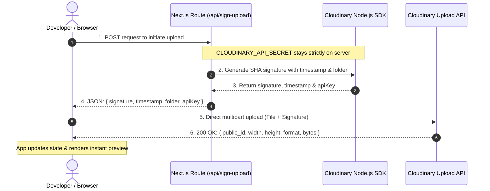
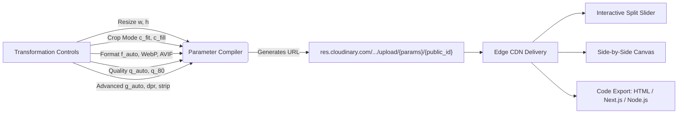
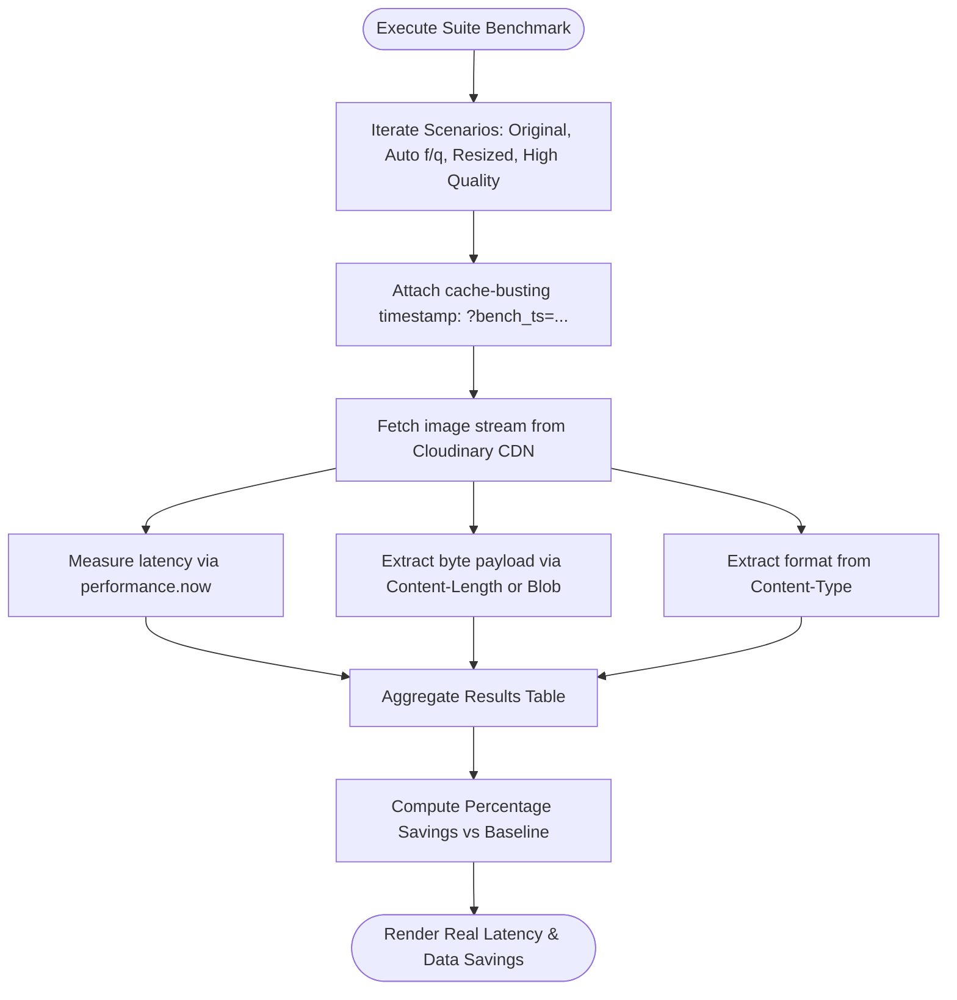

# Transforma 🚀
### Transform. Optimize. Measure.

**Transforma** is an interactive, developer-focused workbench for building, visualizing, comparing, and benchmarking **Cloudinary image-transformation pipelines**.

It allows engineers to construct transformation parameters visually, evaluate the visual quality vs. payload tradeoff in real-time, benchmark CDN delivery speeds against live endpoints, and export production-ready code snippets across frameworks.

---

## 📐 Architecture & Workflow Diagrams

### 1. Authenticated Server-Signed Upload Flow
This diagram illustrates how client image uploads are securely signed without leaking `CLOUDINARY_API_SECRET` to the browser:



---

### 2. Transformation Pipeline & Visual Inspection
This diagram illustrates how visual settings dynamically compile into valid Cloudinary URL segments:



---

### 3. Live Client-Side Benchmarking Workflow
This diagram illustrates how Transforma measures genuine network performance without hardcoded mock data:



---

## ✨ Features Overview

### 1. 🎛️ Interactive Transformation Playground
- **Dual Visual Modes**:
  - **Interactive Split Slider**: Real-time before/after slider with pixel fidelity inspection.
  - **Side-by-Side Mode**: Direct side-by-side comparison with original baseline and delivered output.
- **Floating Status Pills**: Displays real-time file weights (MB → KB), natural dimensions, target aspect ratio, and delivered image format.
- **Zoom & Inspection**: In-browser canvas zoom (`- 100% +`) with full-bleed display mode.

### 2. ⚙️ Transformation Builder Controls
- **Smart Resize & Dimension Presets**:
  - Custom Width & Height numeric controls.
  - 1-click preset badges: `320px`, `640px`, `800px`, `1200px`, `1920px`.
- **Cropping & Scaling Modes**:
  - `c_fit`: Limits dimensions without distortion.
  - `c_fill`: Smart cropping to fill target aspect ratio.
  - `c_crop`: Direct extraction around focal points.
  - `c_scale`: Direct scaling.
- **Next-Gen Format Negotiation**:
  - `f_auto`: Automatically negotiates WebP or AVIF based on requesting browser headers.
  - Manual overrides: WebP, AVIF, JPEG, and PNG.
- **Quality & Compression**:
  - Automatic quality: `q_auto`.
  - Manual precision compression slider (`20%` to `100%`).
- **Advanced Delivery Options**:
  - `dpr_auto`: Device pixel ratio optimization for high-density Retina displays.
  - `g_auto`: AI subject & face-aware smart gravity.
  - `fl_strip_profile`: Strips camera metadata (EXIF/ICC) to save up to 15% byte weight.
- **1-Click Reset**: Instant reset back to recommended production defaults.

### 3. ⚡ Auditable Live CDN Benchmarking
- **Zero Mock Metrics**: Executes genuine client-side network requests via the browser's Fetch & Performance APIs against Cloudinary's edge CDN.
- **Live Audits**: Measures downloaded bytes (via Content-Length / stream analysis), detected dimensions, format headers, and network roundtrip latency in milliseconds.
- **Baseline Comparison**: Compares un-transformed originals against auto-optimized, resized, and high-fidelity configurations with percentage byte-savings indicators.

### 4. 📦 Authenticated Server-Signed Uploads
- Direct browser-to-Cloudinary upload pipeline.
- Uses Next.js Route Handlers (`POST /api/sign-upload`) to generate cryptographically signed SHA upload parameters with the official Cloudinary Node.js SDK.
- Restricts uploads strictly to the `transforma-pipeline/` folder.
- **Security**: `CLOUDINARY_API_SECRET` remains strictly server-side and is never bundled into client JavaScript.
- **Zero-Setup Demo Fallbacks**: Pre-configured with official Cloudinary demo assets so you can explore without requiring upfront credentials.

### 5. 📑 Polyglot Code & URL Export
Instant 1-click copy for:
- Direct Cloudinary CDN Delivery URL.
- Responsive HTML5 `` markup.
- Next.js `<Image />` component with responsive attributes.
- Cloudinary Node.js SDK integration snippet.
- JavaScript client-side loader snippet.

### 6. 💾 LocalStorage Pipeline Recipes
- Persist custom transformation configurations with custom names and notes.
- Instant 1-click reload back into the playground.
- Local browser storage with zero external database dependencies.

### 7. 🎨 Asset Gallery & Quick Recipes
- Built-in library of diverse test assets (landscapes, portraits, products, subjects) to test pipeline behavior across varied photographic content.
- Pre-curated recipe catalogue (*Web Optimized*, *Mobile Image*, *Desktop Hero*, *Thumbnail*, *High Quality*).

### 8. 📱 Responsive Dark Studio Theme
- Sophisticated charcoal & midnight developer theme (`#080c14`, `#0e1424`).
- Responsive layout across desktop, tablet, and mobile (iPhone SE 375px+).
- Slide-out navigation drawer with blurred backdrop on mobile screens.
- Global search command palette (`⌘K` / `Ctrl+K`) for presets and platform views.

---

## 🛠️ Technology Stack

- **Framework**: [Next.js](https://nextjs.org) (App Router, Turbopack)
- **Language**: TypeScript
- **Styling**: Tailwind CSS
- **Icons**: [Lucide React](https://lucide.dev)
- **SDK**: Official [Cloudinary Node.js SDK](https://cloudinary.com/documentation) (`cloudinary` package)

---

## 🚀 Getting Started

### 1. Clone the repository & install dependencies

```bash
git clone https://github.com/ab2030909/Transforma.git
cd Transforma
npm install
```

### 2. Configure Cloudinary Credentials

Copy `.env.example` to `.env.local`:

```bash
cp .env.example .env.local
```

Add your Cloudinary account credentials from your [Cloudinary Console](https://console.cloudinary.com):

```env
CLOUDINARY_CLOUD_NAME=your_cloud_name
CLOUDINARY_API_KEY=your_api_key
CLOUDINARY_API_SECRET=your_api_secret

NEXT_PUBLIC_CLOUDINARY_CLOUD_NAME=your_cloud_name
```

> **Note**: Even if you run Transforma without API keys, it will function using Cloudinary's verified demo assets, allowing you to test all transformations, presets, and live benchmarks immediately!

### 3. Start Development Server

```bash
npm run dev
```

Open [http://localhost:3000](http://localhost:3000) in your browser.

---

## 🔐 How Upload Signing Works

1. The client triggers an image upload through the **Upload Image** button or drag-and-drop.
2. The browser requests signed parameters by calling `POST /api/sign-upload`.
3. The server generates a timestamp and creates an authenticated SHA signature using `CLOUDINARY_API_SECRET` and the official Cloudinary Node.js SDK:
   ```ts
   const signature = cloudinary.utils.api_sign_request(
     { folder: 'transforma-pipeline', timestamp },
     process.env.CLOUDINARY_API_SECRET
   );
   ```
4. The client receives the signature, timestamp, and API key.
5. The image is uploaded directly from the browser to `https://api.cloudinary.com/v1_1/<cloud_name>/image/upload`.
6. Returned `public_id`, `width`, `height`, `format`, and byte weight are saved into application state.

---

## 📊 Benchmarking Details & Limitations

- The live benchmarking engine tests real HTTP network requests against Cloudinary's edge distribution network.
- **Downloaded Bytes**: Verified using the HTTP `Content-Length` header or raw blob size.
- **Network Latency**: Measured using the browser's `performance.now()` API.
- **Cache vs Fresh**: Cloudinary caches generated transformations at edge points. The benchmarking suite appends unique cache-busting timestamps to test both cold and warm edge response times.

---
